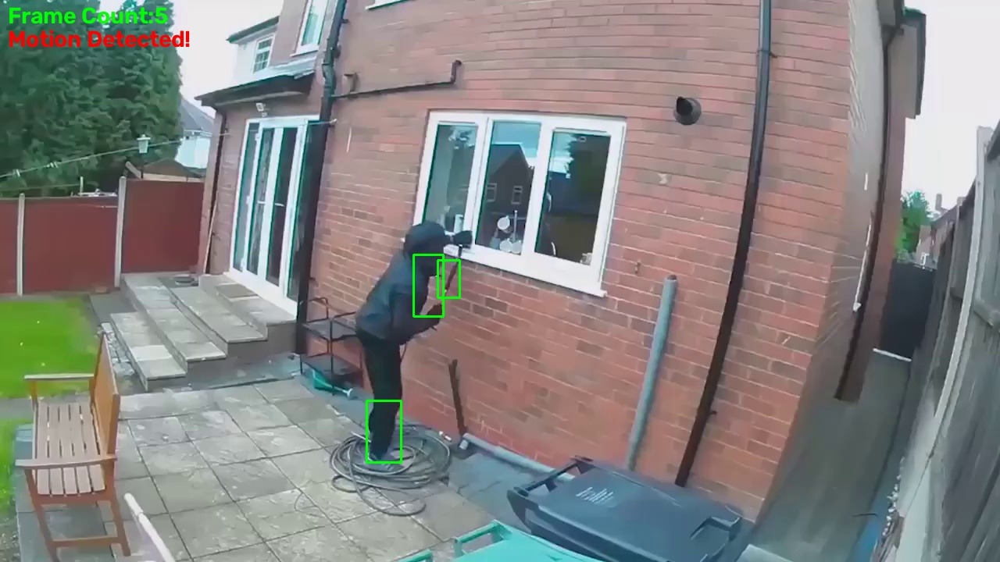

# Burglar Detection

Motion detection on video footage using OpenCV. The script compares frames that are a few steps apart, finds the regions that changed, draws bounding boxes around them and saves every frame where motion is detected.

## Sample Output



Frame 5 of the input video, saved automatically by the script. The green boxes mark the regions where motion was found, and the overlay text shows the frame count and the detection status.

## How It Works

The approach is classical frame differencing, with no trained model involved.

1. Read a frame from the video and convert it to grayscale.
2. Keep a rolling buffer of the most recent frames. The oldest and newest frames in the buffer are 5 frames apart.
3. Compute the absolute difference between those two frames with `cv2.absdiff`.
4. Apply a binary threshold at 30, so only pixels that changed noticeably are kept.
5. Find the outlines of the changed regions with `cv2.findContours`.
6. Ignore contours with an area below 300 pixels, which removes small noise, and draw a bounding box around the rest.
7. If at least one region remains, show "Motion Detected!" on the frame and save it as `motion_frame_<frame number>.jpg`.

Comparing frames 5 apart instead of consecutive frames makes slow movement easier to pick up, because the difference between the two frames is larger.

## Configuration

| Variable | Default | What it controls |
|----------|---------|------------------|
| `gap` | `5` | Number of frames between the two frames that are compared |
| `min_area` | `300` | Smallest contour area (in pixels) that counts as motion |
| Threshold value | `30` | Pixel difference needed to count as changed (set inside `cv2.threshold`) |

The best values depend on the video resolution and how far the camera is from the scene, so they may need adjusting for different footage.

## Setup

From the repository root:

```bash
cd Burglar-Detection
pip install -r requirements.txt
```

Using a virtual environment is recommended. See the [root README](../README.md) for the steps.

## Usage

The demo video is not included in this repository. Place your own video in this folder and name it `input_video.mp4`, then run the script from inside this folder:

```bash
python burglar_detection.py
```

The video path is relative, so the script must be run from the `Burglar-Detection` folder.

### Using a webcam

To run on a live camera feed, change the source in the script:

```python
cap = cv2.VideoCapture(0)
```

`0` is the default camera. Try `1` if you have more than one.

### Controls

- Press `ESC` to quit.
- Closing the window also stops the script.

### Saved frames

Every frame with detected motion is written to the current folder as `motion_frame_<n>.jpg`, so a long video can produce a lot of images. These files are ignored by Git, except for `motion_frame_5.jpg`, which is kept as the sample output.

## Demo Video Credit

The footage used while building this project is from YouTube and is not redistributed here: [YouTube link here](https://www.youtube.com/watch?v=48ULaN___wU)

All rights belong to the original owner.

## Tech Stack

- Python
- OpenCV (`opencv-python`)

## Project Structure

```
Burglar-Detection/
├── burglar_detection.py
├── motion_frame_5.jpg
├── requirements.txt
└── README.md
```